

  

  
  
  
  
  
  

<b>Case study</b> · Delivered 2026 · Client kept confidential

---

## 🏢 The Client

A **single business group operating as two companies** in Saudi Arabia, a **multi-branch retail & wholesale operation** with:

- 🛍️ **Up to 16 retail showrooms** (B2C / point-of-sale)
- 🚚 **Multiple wholesale branches, central warehouses and van-sales channels** (B2B)
- 🧾 Everything running on **Odoo ERP**, with data in **English and Arabic**

## 😩 The Problem

> *"We have all the data in Odoo, but getting a straight answer takes days."*

- 📑 Every department built its own reports **by hand in Excel**, so numbers rarely matched between teams.
- 🐢 Management decisions were waiting on **exports, copy-paste and reconciliation**.
- 🧩 Two companies, retail and wholesale, many warehouses, with **no single combined view** of the business.
- 🔒 The client was on **Odoo's affordable shared hosting**, which **does not allow direct database access**. The standard "connect the database to BI" tools on the market simply could not be used.

## 💡 The Solution

A fully automated reporting system that **pulls data out of Odoo every night, cleans it, and delivers ready-to-read dashboards to every department by morning**, with no one touching a spreadsheet.

| | Before | After |
|---|---|---|
| ⏱️ **Report turnaround** | Days of manual Excel work | Ready every morning, automatically |
| 🎯 **Consistency** | Each team had its own numbers | One shared model, one version of the truth |
| 🏬 **Visibility** | Company by company, branch by branch | Both companies, all showrooms, warehouses and channels in one place |
| 🛡️ **Reliability** | Nobody knew when a report was wrong | Automatic alerts if anything fails or changes |
| ⚙️ **Flexibility** | Fixed manual process | Refresh schedule tailored to the business |

  

> Page count undersells it. Each page carries drill-downs, slicers, toggles and comparisons that used to be separate Excel files.

---

## 🗺️ How It Works

  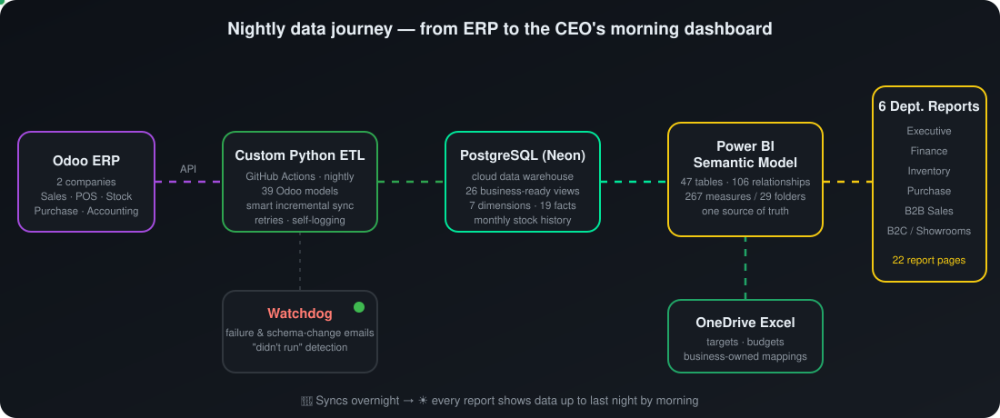

1. **Odoo** stays exactly as the team uses it today. Nothing changes for them.
2. A **custom-built Python pipeline** connects through Odoo's API and runs automatically every night on **GitHub Actions**.
3. The data lands in a **cloud PostgreSQL warehouse (Neon)**, where it is shaped into **clean, business-ready SQL views**.
4. One central **Power BI semantic model** holds all the business logic, KPIs, targets and budgets.
5. **Six lightweight department reports** connect to that single model, so every team sees the same numbers.

---

## 📊 The Reports

  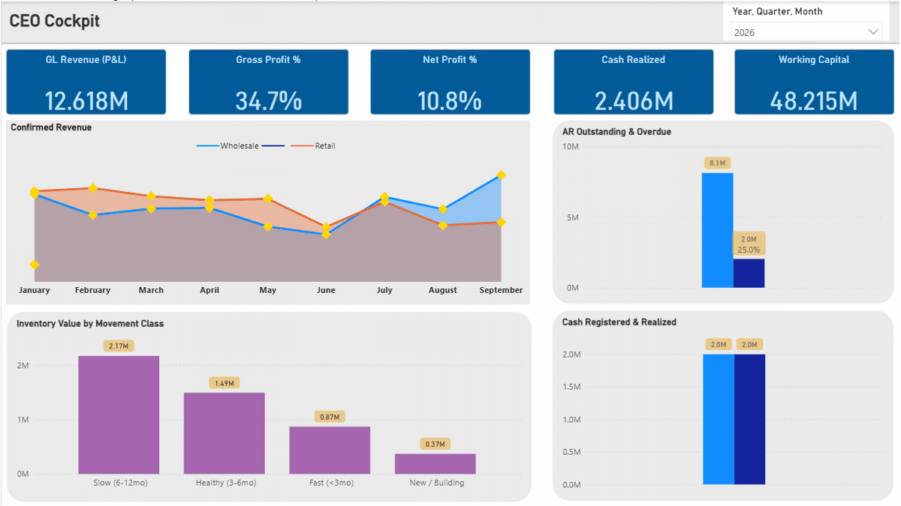
   <i>Actual report pages. Names and figures replaced with mock data to protect client confidentiality.</i>

<!-- 🎥 Optional: record a 20-sec screen capture of the real Power BI file (mock data) clicking slicers/toggles, save as assets/interactive-demo.gif and uncomment:

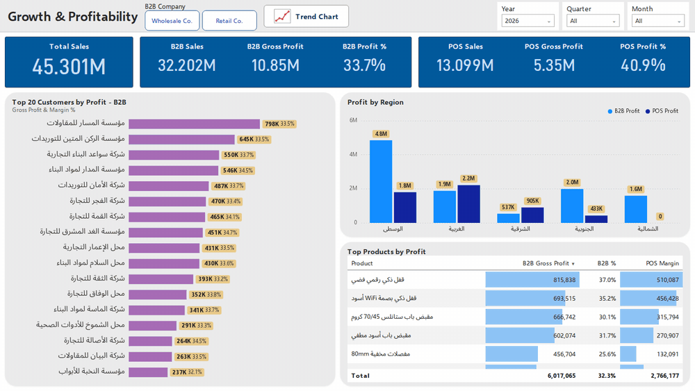

-->

<table>
<tr>
<td width="50%" valign="top">

### 👔 Executive · 3 pages
CEO Cockpit · Growth & Profitability · Working Capital
 Sales, profit, cash, receivables, inventory health and the cash conversion cycle on one screen.

### 💰 Finance · 5 pages
Balance Sheet · P&L (vs prior year / budget) · Aged Receivables & Payables · Budget vs Actual · Cash Flow

### 📦 Inventory · 5 pages
Item Movement · Warehouse Stock Balance · Stock Requests & Returns · Slow-Moving Inventory · Warehouse Transfers

</td>
<td width="50%" valign="top">

### 🛒 Purchase · 4 pages
Inventory & Item Movement (9-month view) · Monthly Purchasing · Last Purchase Price · Shipment Tracking

### 🤝 B2B Sales · 3 pages
Sales Performance by region & salesperson vs target · SKU Performance & Customer Dashboard · Customer Status

### 🏬 B2C / Showrooms · 2 pages
Showroom Sales & Profitability · Salesperson Performance vs target

</td>
</tr>
</table>

<b>📸 More screenshots</b>

 

**CEO Cockpit**
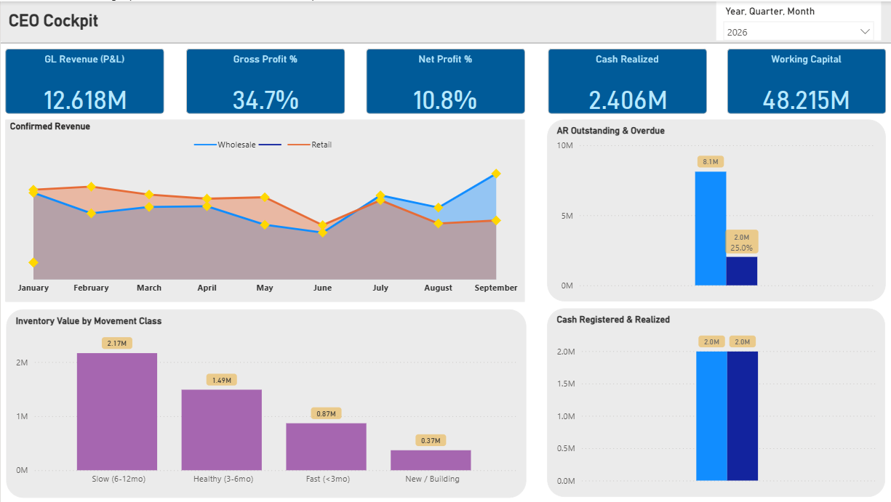

**Growth &amp; Profitability**
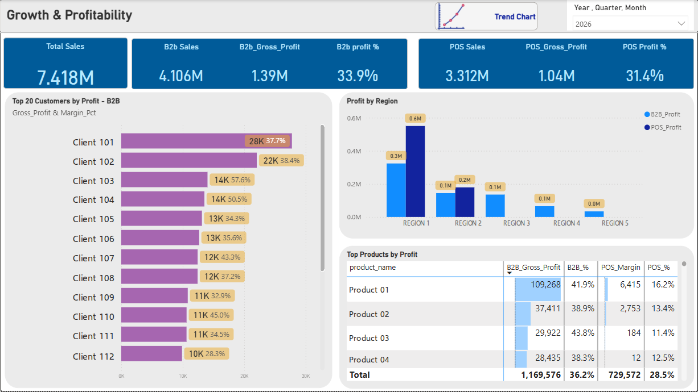

**P&amp;L**
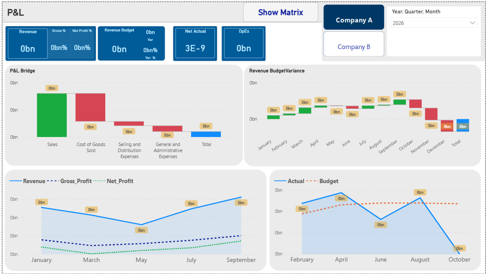

**B2B Sales Performance**
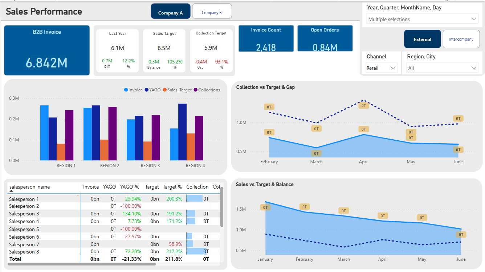

**Customer Analysis**
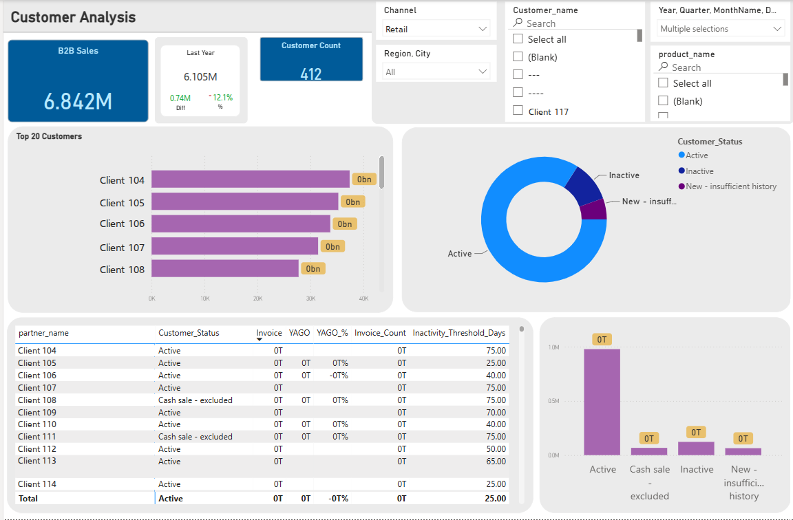

**Slow-Moving Inventory**
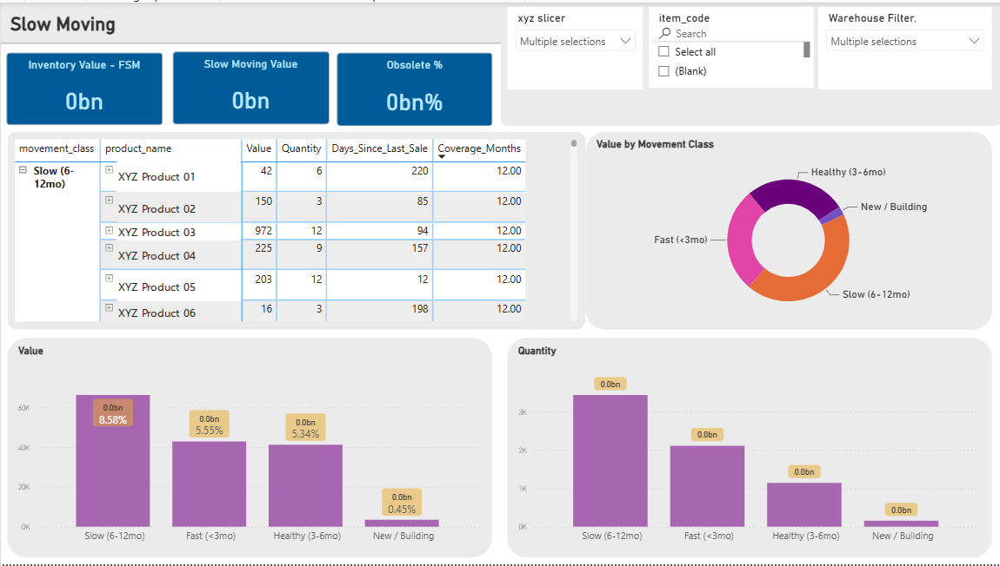

---

## ✨ What Makes It Different

<b>🔌 Works where off-the-shelf connectors can't</b>

 
Most Odoo-to-BI tools need direct database access, which Odoo's shared hosting doesn't allow. This pipeline was <b>custom-built to work through Odoo's API</b>, so businesses on the more affordable Odoo plans can still get proper BI.

<b>⚡ Smart, efficient nightly sync</b>

 
Each data area is synced with the method that suits it: only <b>what changed since last night</b>, a full refresh where accuracy demands it, or a clean reload for live stock. This keeps runs fast and cheap without sacrificing accuracy. A <b>monthly end-of-month stock snapshot</b> builds stock history that Odoo itself doesn't keep.

<b>🛡️ Built to run unattended</b>

 

- Automatic retries when the connection blips
- One failing area never stops the rest of the sync
- **Email alerts** on failures, and on **silent Odoo changes** (e.g. a renamed custom field) that would otherwise quietly break a report
- A **"dead-man's switch"** that raises the alarm if the nightly job doesn't run at all
- A built-in **run history log**, so every sync can be audited after handover
- Read-only access to Odoo. Nothing is ever written back.

<b>🧠 One model, many reports</b>

 
All 267 measures live in a single, published semantic model, organised into 29 folders. The six department reports are "thin" files on top of it, so <b>a KPI is defined once and means the same thing everywhere</b>. Adding a new report doesn't mean rebuilding the logic.

<b>📐 Business logic that finance and operations can defend</b>

 

- **Slow-moving stock** classified by *months of coverage* (stock ÷ real demand, net of returns), not just "days since last sale", so fresh stock isn't wrongly flagged as dead
- **Adaptive customer-activity status**: each B2B customer is judged against their own ordering rhythm
- **Reconciled figures**: where accounting and sales views differ, the gap is explained and bridged, not hidden
- Targets, budgets and category mappings stay in **Excel files the business owns**, so they can update them without a developer

<b>🌐 Bilingual data, two companies, one picture</b>

 
Arabic and English master data, two legal companies, retail and wholesale channels, central warehouses, showrooms and sales vans, all brought into a single consistent model with company-level filtering.

---

## 🧠 Project Map

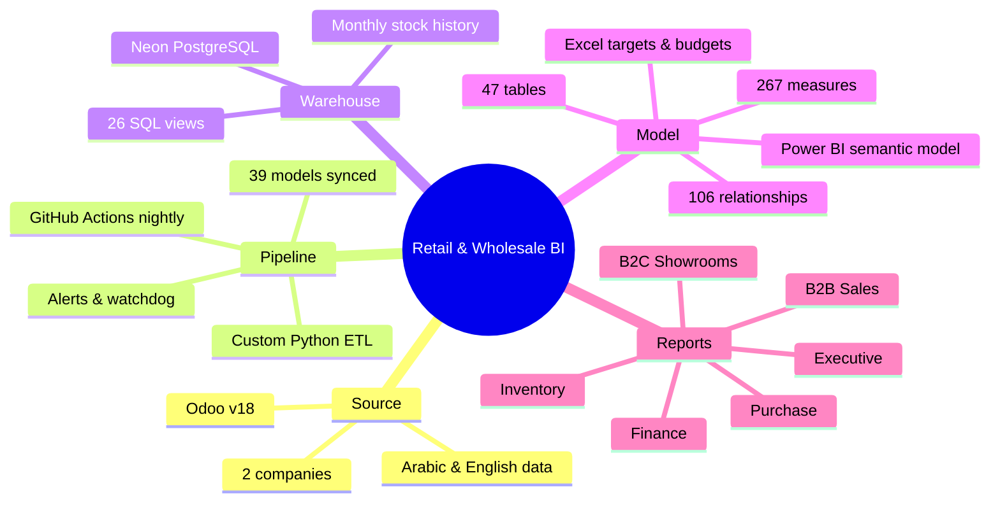

---

## 🧰 Tech Stack

  
  &nbsp;
  
  

`Odoo XML-RPC API` · `Python` · `GitHub Actions (cron)` · `Neon serverless PostgreSQL` · `SQL views` · `Power BI semantic model` · `DAX` · `Power Query` · `OneDrive / Excel` · `Email alerting` · `Uptime monitoring`

---

## 🔒 A Note on Confidentiality

The client's name, data and source code are not published. All screenshots use mock figures, and every customer, salesperson, product and company name has been replaced. The pipeline is proprietary work and is not available in this repository.

---

## 🤝 Work With Me

<table>
<tr>
<td width="65%">

**Running Odoo and still reporting in Excel?**

I build end-to-end BI on top of Odoo: data pipeline, data warehouse, Power BI model and department dashboards. It works even on Odoo's shared hosting. Refresh schedules, KPIs and reports are shaped around how *your* business actually runs.

- 📊 Executive, finance, sales, inventory and purchase reporting
- 🔄 Fully automated, monitored data pipelines
- 🏢 Multi-company, multi-branch, bilingual data

</td>
<td width="35%" align="center">

### Abdul Sami
BI Analyst · Power BI Developer · Data Engineer

📍 Saudi Arabia · Available for projects

</td>
</tr>
</table>

  

